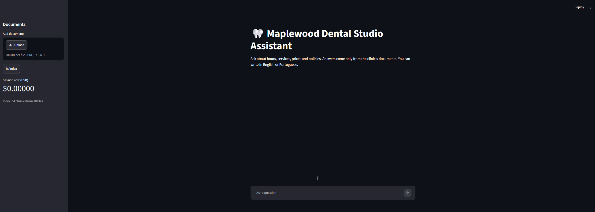
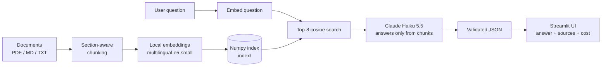

# Document Q&A Chatbot

A RAG chatbot that answers questions about a company's documents, cites its sources, and says "I don't know, please contact the front desk" when the answer isn't in the docs.




## The problem

Staff and clients waste time searching through policies, FAQs and price lists to answer simple questions. This project lets anyone ask in plain language (English or Portuguese) and get a short answer grounded in the company's own documents, with the source shown.

## Features

- Chat in Portuguese and English: the answer comes back in the language of the question.
- Source citations: every answer lists the document, section and page it came from.
- "I don't know" fallback: if the documents don't contain the answer, the bot says so and points to the front desk instead of guessing.
- Cost per question and session total, shown in the UI.
- Upload PDF, TXT or MD files and reindex from the sidebar.

## How it works

1. **Load** the documents (`.md`, `.txt`, and `.pdf` page by page; repeated PDF headers are removed).
2. **Section-aware chunking**: split at headings first, then by paragraph into chunks of up to 800 characters with 150 characters of overlap (never across sections).
3. **Local embeddings** with `intfloat/multilingual-e5-small`. Each chunk is embedded together with a header such as "Our Team > Dentists > Dr. Priya Nair".
4. **Numpy cosine index**: normalized vectors saved in `index/`, searched with a dot product.
5. **Top-K retrieval**: the 8 chunks most similar to the question.
6. **Claude answers ONLY from the retrieved chunks** (Claude Haiku 5.5) and returns JSON: `answered`, `answer`, `sources`. The code validates it: chunk ids that weren't retrieved are dropped, and malformed output counts as "not answered".
7. **The UI** shows the answer, its sources and the cost.



## Sample knowledge base

`knowledge_base/` holds 10 fictional documents (4 PDF, 3 Markdown, 3 TXT) for **Maplewood Dental Studio**: hours, services and prices, insurance, booking policy, FAQ, team, aftercare, a new-patient guide, a privacy policy and a front desk manual.

Some topics are intentionally missing, to test the fallback: dental implants, braces/Invisalign, medication dosage and pets.

## Tech stack

- Python 3.12
- [Streamlit](https://streamlit.io) for the UI
- [Anthropic API](https://docs.anthropic.com) (`claude-haiku-5-5`) for answers
- [sentence-transformers](https://www.sbert.net) with `intfloat/multilingual-e5-small` for embeddings
- numpy for the vector index, pypdf for PDF text
- python-dotenv for the API key, pytest for tests

## Setup

You need Python 3.12 and an [Anthropic API key](https://console.anthropic.com).

**Windows (PowerShell)**

```powershell
git clone https://github.com/gabrielbf7/document-qa-chatbot.git
cd document-qa-chatbot
python -m venv .venv
.\.venv\Scripts\Activate.ps1
pip install -r requirements.txt
Copy-Item .env.example .env
# open .env and put your key after ANTHROPIC_API_KEY=
python -m src.indexer build
streamlit run app.py
```

**macOS / Linux**

```bash
git clone https://github.com/gabrielbf7/document-qa-chatbot.git
cd document-qa-chatbot
python3 -m venv .venv
source .venv/bin/activate
pip install -r requirements.txt
cp .env.example .env
# open .env and put your key after ANTHROPIC_API_KEY=
python -m src.indexer build
streamlit run app.py
```

The first index build downloads the embedding model (a few hundred MB). After that it runs offline.

You can also search from the terminal without the API: `python -m src.indexer search "your question"`, or ask a full question with `python -m src.qa ask "your question"`.

## Evaluation & tests

```bash
python -m src.qa eval   # 10 questions (5 EN, 5 PT), real API calls
python -m pytest        # 32 tests, no API calls
```

The eval checks that answerable questions (opening hours, cleaning price) are answered with sources, and that out-of-scope ones (implants, Invisalign, ibuprofen dosage) fall back to "I don't know". Latest run: **10/10**. All 32 tests pass.

## Cost

- Embeddings run locally: free.
- About **US$0.0002 per question** with Claude Haiku 5.5.
- The whole development, including every evaluation run, cost under US$0.01 in API calls.

## Limitations

- No conversation memory: each question is answered independently.
- "List all" questions may miss items, especially in Portuguese. For example, asking for every dentist's specialty returns only some of them.
- e5-small similarity scores are compressed (all around 0.77 to 0.84), so a score threshold can't tell whether the answer exists. The LLM decides.
- Scanned PDFs are not supported (no OCR).
- Uploads are stored locally only.

## Privacy

- The documents are fictional. Don't put real patient data in the sample base.
- The retrieved excerpts and the question are sent to the Anthropic API to generate the answer.
- The API key lives in `.env` (ignored by git) and never in the code.

## Possible improvements

- Conversation memory.
- Re-ranking or hybrid (keyword + embedding) search.
- A larger embedding model.
- FAISS or ChromaDB for larger knowledge bases.
- Deployment.

## Project structure

```
.
├── app.py                 # Streamlit UI
├── src/
│   ├── config.py          # constants (models, chunk size, TOP_K, prices)
│   ├── loaders.py         # MD / TXT / PDF loading
│   ├── chunker.py         # section-aware chunking
│   ├── indexer.py         # embeddings, index build and search (+ CLI)
│   ├── qa.py              # prompt, Claude call, JSON validation (+ CLI, eval)
│   └── uploads.py         # safe saving of uploaded files
├── knowledge_base/        # 10 fictional Maplewood Dental Studio documents
├── tests/                 # pytest tests
├── docs/                  # demo.gif and screenshot.png
├── index/                 # generated index (git-ignored)
├── uploads/               # user uploads (git-ignored)
├── requirements.txt
└── .env.example
```

## Author

Gabriel Fantin: [github.com/gabrielbf7](https://github.com/gabrielbf7)
